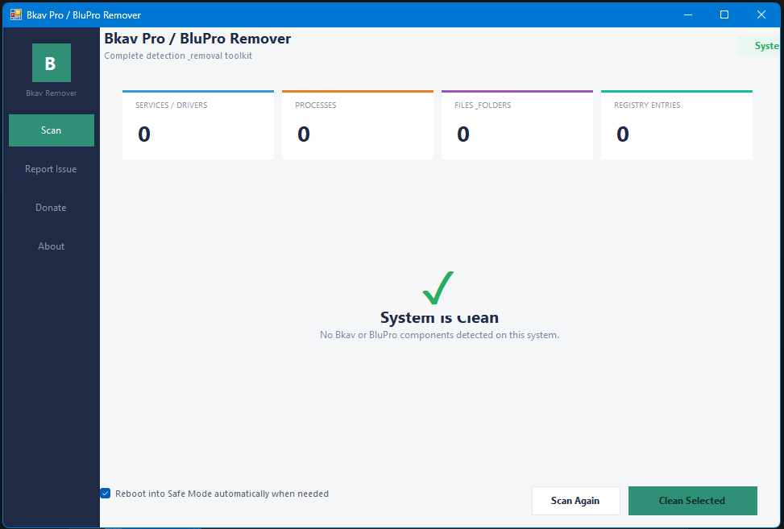
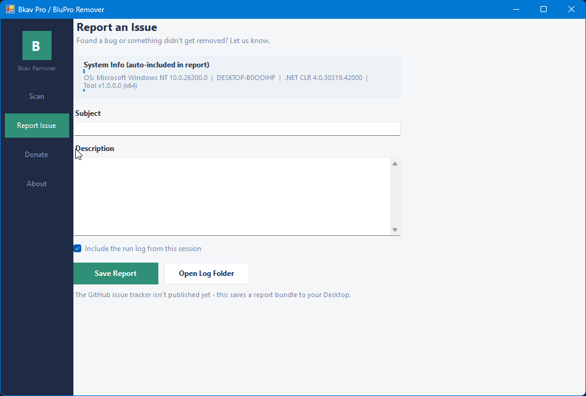

# Bkav Pro / BluPro Remover

Fully automatic removal tool for **Bkav Pro** and **BluPro** antivirus on Windows 7+.

Bkav uses a kernel-level self-protection driver (PPL) that blocks normal uninstall. This tool handles the full sequence automatically: scan → disable services → reboot into Safe Mode → clean everything → reboot back → verify.

## Download

| Platform | Link |
|---|---|
| Windows x64 | [BkavProRemover-x64.exe](https://github.com/ThanhNguyenVN93/BkavProRemover/releases/latest/download/BkavProRemover-x64.exe) |
| Windows x86 | [BkavProRemover-x86.exe](https://github.com/ThanhNguyenVN93/BkavProRemover/releases/latest/download/BkavProRemover-x86.exe) |

> **Requires:** Administrator rights. Works on Windows 7 SP1 through Windows 11.  
> Single `.exe`, no installer, no .NET install needed (.NET 3.5 is built into Windows).

## Screenshots

<p align="center">
  
</p>

<p align="center">
  
</p>

## How it works

1. **Scan** - Detects all Bkav/BluPro services, processes, files, scheduled tasks and registry entries.
2. **Prepare** - Disables services and sets up an automatic Safe Mode boot with a RunOnce key.
3. **Clean (Safe Mode)** - On the next boot the tool auto-starts, kills remaining processes, deletes files, removes services and registry entries.
4. **Verify** - Reboots back to Normal Mode and re-scans to confirm complete removal.

If Bkav is already mostly disabled (no kernel driver running), the tool skips Safe Mode and cleans directly.

## Why Safe Mode?

Bkav's kernel driver (PPL - Protected Process Light) prevents termination and file deletion while running. Safe Mode does not load third-party kernel drivers, so the files can be deleted and services can be removed cleanly.

## Usage

1. Download the exe for your Windows version (x64 or x86).
2. Right-click → **Run as administrator**.
3. Click **Scan Again** to detect Bkav components.
4. Click **Clean Selected** and confirm.
5. The tool handles everything automatically, including reboots.

## Report a problem

If something wasn't removed or you encounter an error, use the **Report Issue** tab inside the tool.  
It saves a bundle (system info + run log) locally and opens the [GitHub issue tracker](https://github.com/ThanhNguyenVN93/BkavProRemover/issues/new) in your browser so you can submit it.

## Build from source

Requirements: Visual Studio 2019+ or MSBuild for .NET Framework.

```powershell
# Build both x86 and x64
.\build\build.ps1
# Output: dist\x86\BkavProRemover.exe  dist\x64\BkavProRemover.exe
```

The Core library is compiled directly into the exe (no separate DLL).

## License

MIT - see [LICENSE](LICENSE)

---

Developed by [Nguyen Thanh](https://nguyenthanhdev.com) | [Support the project](https://nguyenthanhdev.com/donate/)
